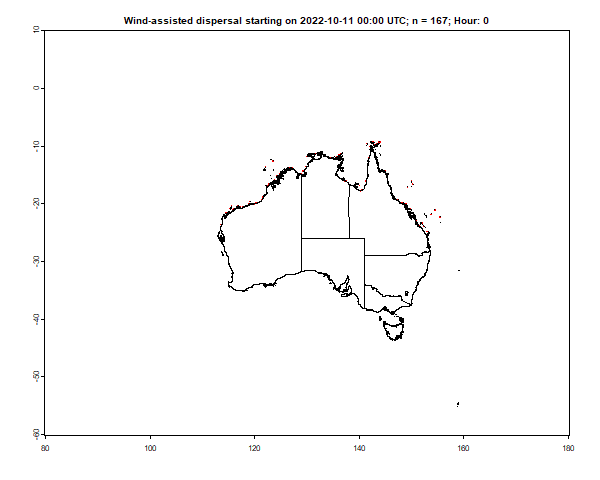
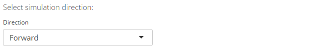
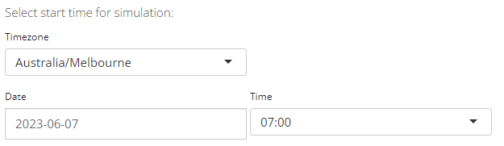
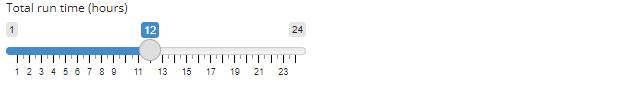
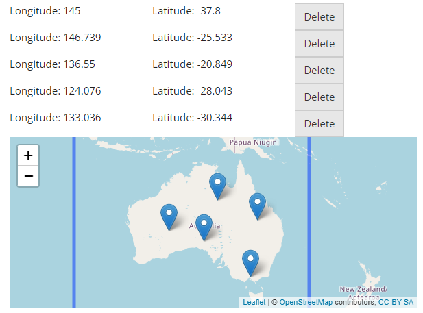

## Wind Dispersal Forecasting Tool

This is an app developed by [Cesar Australia](https://cesaraustralia.com/) to predict the wind-assisted dispersal of Fall Armyworm (FAW; *Spodoptera frugiperda*).
The app runs real-time simulations of dispersal using the cellular automata model, allowing users to predict the direction and distance that FAW will travel under different scenarios. 
FAW is a lepidopteran pest species which causes major damage to economically important cultivated grasses, vegetable crops, and cotton. It was first reported in Australia in January 2020, and has rapidly spread across Eastern Australia.
As this pest can migrate large distances over short periods of time, regular monitoring and surveillance are vital. Knowing when the adult moths are likely to appear in an area helps to inform monitoring for larvae, and proactive management if required. 

**Current version: v1.1.1** (see [What's new](#whats-new-in-v111)).

   

### Cellular automata model for wind-assisted dispersal

The cellular automata (CA) model for wind-assisted dispersal was developed by Cesar Australia research scientists as part of a project funded by Plant Health Australia to help predict movements of FAW in Australia. 

The CA algorithm was developed to provide quick and efficient simulations of the direction and speed that FAW will travel via wind-assisted dispersal. The model incorporates both localised information and broad scale weather data to calculate where the moths will disperse to from selected starting locations. 

Each simulated moth moves in one-hour steps. In each hour, the distance it travels is set by the wind speed where it is, and its direction by the wind in and around its current cell, with some random variation. Repeating the simulation many times from the same starting point therefore traces out a spread of possible paths, and the map shows how often each cell is crossed.

A full description of the model and validation against recorded FAW movements in Eastern Australia will be made available when published.

#### What's new in v1.1.1

* **Longer backward simulations now work correctly.** Previously, backward simulations beyond about 43 hours could fail depending on the start time, because all wind data was read from a single GFS forecast cycle. The model now reads each simulation hour from the best available cycle for that time, so any duration up to 96 hours works reliably.
* **Updated movement model.** Simulated moths now travel the full distance carried by the wind. Previously, movement was capped at roughly one grid cell (about 25 km) per hour whatever the wind speed. The distance and direction of each move also now account for grid cells being narrower (east-west) further from the equator. **Maps from this version are therefore not directly comparable with maps from earlier versions**: trajectories are generally longer, particularly in strong winds.
* **Smoother maps.** Each simulation now runs 100 replicate trajectories per locality (previously 10).
* **Much faster.** Simulations typically finish within a few seconds instead of minutes.
* **Model area shown and checked.** The area covered by the wind data is outlined with a dashed line on the maps. Localities outside it cannot be selected, and a warning appears above the results if many trajectories leave the area (see [Reading the results](#reading-the-results)).
* **Clearer errors.** If a simulation cannot be completed (for example because the latest forecast has not finished downloading), a message is shown and the previous result stays on screen, instead of the app stopping.
* **Multi-site forecast shared per day.** The Multi-site Northern Prediction is calculated once per day and shared between users.
* Smaller fixes: the list of selected localities can no longer get out of step when deleting, your chosen date, time and run time are kept when you change other settings, and the latest available start time is now always calculated using Brisbane time.

#### Data used for simulations

Meteorological forecast cycles in 6 hour intervals (UTC 00:00, 06:00, 12:00, 18:00) at a 0.25 degrees spatial resolution (roughly 25 x 25 km) are sourced from the [NOAA Global Forecast System (GFS)](https://www.ncei.noaa.gov/products/weather-climate-models/global-forecast). Data are downloaded daily at 08:00 AEST and are kept for a week.

 

### Using the forecasting tool

The default use of the tool is to perform a **Rapid simulation** based on user-defined input. You will be prompted to select among several parameters:

1. Select whether to run the simulation forwards (i.e. showing where the moths are predicted to disperse to) or backwards (i.e. predicting where the moths came from).

2. Select a timezone and date and time for your simulation. You can run simulations ranging up to a week prior to the current date.

3. Select the total flight duration of FAW, up to 24 hours for forward simulation, up to 96 hours (four days) for backward simulation.

4. Locality: The location of moths present to predict their direction of travel (forwards) or their predicted origin (backwards). You can click on the map to select up to five localities for the simulation. Localities must be inside the dashed outline (the model area); a click outside it is ignored and a message is shown. Delete selected localities by pressing on the adjacent button.

*Note that simulations normally take only a few seconds, and backward simulations up to 96 hours are fully supported. Longer run times and more localities will take a little longer. If the simulation cannot be completed (for example, if you are running it close to the latest forecast time and the forecast has not finished downloading), a message will appear: please try again in a few minutes. If the error persists, contact Cesar Australia for support.*

After you have selected all of your starting conditions, press the **Run forecast** button. The results of your simulation will show up on the right, with cells coloured based on the frequency of simulated trajectories passing through them.

Alternatively, you can switch to the **Multi-site Northern Prediction** tab to simulate overnight dispersal from localities where there is a year-round risk of FAW. Select your timezone of choice, and press the **Run forecast** button to generate a map of where FAW may have dispersed to overnight. This forecast is calculated once per day and shared between users, so the first run of the day may take a little longer than later ones.

#### Reading the results

The red star(s) on the map mark the localities the result was run for. The dashed red line marks the edge of the model area, which is the extent of the downloaded wind data. Trajectories that reach this edge cannot be followed any further, so the pattern of the map is cut off there.

If more than 10% of the simulated trajectories leave the model area, a warning is shown above the map. In that case, treat the map near the edge with caution, and remember that for backward simulations the true source may lie beyond the edge. This is most likely for long runs, strong winds, and localities close to the edge of the model area (particularly the 96 hour backward simulations).

 

For more information on surveillance and how to monitor for and manage FAW see:

[The Beatsheet article – QLD](https://thebeatsheet.com.au/key-pests/fall-armyworm/)

[NSWDPI surveillance – NSW](https://www.dpi.nsw.gov.au/biosecurity/plant/insect-pests-and-plant-diseases/fall-armyworm/)

[PestFacts south-eastern article – Vic](https://cesaraustralia.com/pestfacts/fall-armyworm-victoria-maize/)

 

### For maintainers

**Files.** `app.R` is the Shiny app. The model lives in `R/`:

| File | Purpose |
|---|---|
| `R/wind_ca.cpp` | C++ implementation of the CA model (Rcpp) |
| `R/wind_ca_model_cpp.R` | R wrapper: reads the wind data once, calls the C++ model, builds the output raster |
| `R/wind_ca_fixed_r.R` | Pure-R implementation of the same model, used if the C++ code cannot be compiled |

`R/wind_scr.R` and `R/wind_ca_model.R` (the original R model) are no longer used by the app.

**Wind data reading (Option B).** Each simulation hour is read from the most recent available GFS cycle for that specific hour's valid time, rather than from a single cycle for the whole run. Only files `f000`–`f005` are ever needed from any cycle, and any run length up to 96 hours works as long as enough cycle folders are on disk. If the nearest cycle folder is missing, the model silently falls back to the next older one (up to 48 hours back).

**Model engine.** On startup the app compiles `R/wind_ca.cpp` with `Rcpp::sourceCpp()`. This needs the Rcpp package and a C++ compiler in the container. If compilation fails, the app logs the reason and runs the pure-R implementation instead (same model, a little slower). The container log shows `[wind model] engine: cpp` or `engine: r`.

**Settings** are at the top of `app.R`:

| Setting | Meaning |
|---|---|
| `NSIM` | replicate trajectories per locality (100) |
| `WIND_DIR`, `ATM_LEVEL` | wind data folder and pressure level (`950mb`) |
| `MAX_POINTS` | maximum localities on the Rapid simulation tab (5) |
| `EXIT_WARN_FRACTION` | share of trajectories leaving the model area that triggers the warning (0.10) |
| `LATEST_TZ` | timezone used for the latest available start time (08:00 Brisbane time) |
| `MODEL_VERSION` | change to invalidate cached multi-site forecasts |
| `CACHE_DIR` | where the daily multi-site forecast is cached |

**Daily cache.** The Multi-site Northern Prediction is saved to `CACHE_DIR` (default `wind-forecast-cache` in the system temporary folder, shared by all R processes in the container; set the `WIND_CACHE_DIR` environment variable to use another folder, e.g. a mounted volume, so it survives restarts). The cache key includes the settings and a hash of the model code, so changing either re-runs the forecast. Files older than three days are removed at startup, and an unreadable cache file is ignored and rebuilt.

**Model area.** The model area is defined by the extent of the downloaded wind data. `SpatialData/boundary.gpkg` should match it, because it is used to draw the dashed outline and to reject localities outside it. If you widen the area downloaded by the wind-data job, regenerate `boundary.gpkg` to match. A wider area reduces the number of trajectories cut off at the edge, at the cost of more memory per simulation.

**Replicates leaving the model area.** The model reports how many replicates left the wind-data area. The app uses this for the warning above the map.

 

### Contact details

For any questions about the model, suggestions for the online tool, or requests for information or new functionalities, please contact [Alex Slavenko](mailto:aslavenko@cesaraustralia.com?subject=Wind%20Dispersal%20Forecasting%20Tool) at Cesar Australia.

This tool was developed as part of Cesar Australia project CE1805CR3 with funding by Plant Health Australia (PHA).
